# Extreme Programming Assignment — Address Book

> Course: Software Engineering (FZU–MU)　Student ID: 832402228　Name: Zhou Qican (周祺粲)
> Completed: 2026-11-17

---

## Course Information

| Item | Content |
| --- | --- |
| **Course for This Assignment** | Software Engineering (FZU–MU) |
| **Team Name** | Individual project (832402228 Zhou Qican) |
| **Assignment Requirements** | [Extreme Programming (Deadline: November 17, 2026, 23:59)](https://bbs.csdn.net/topics/620593436) |
| **Objectives of This Assignment** | Build a web address book that supports bookmarking contacts, multiple contact methods per contact, and Excel import/export; practise module decomposition, the Git branch + Pull Request workflow, automated testing and technical writing |
| **Other References** | [Spring Boot documentation](https://spring.io/projects/spring-boot), [Apache POI documentation](https://poi.apache.org/), [SQLite documentation](https://www.sqlite.org/docs.html), [Google Java Style Guide](https://google.github.io/styleguide/javaguide.html), [Conventional Commits](https://www.conventionalcommits.org/en/v1.0.0/) |

---

## Table of Contents

- [1. Project Links](#1-project-links)
- [2. Commit History and Contribution Statistics](#2-commit-history-and-contribution-statistics)
- [3. Implementation Design](#3-implementation-design)
  - [3.1 Data Model](#31-data-model)
  - [3.2 Bookmarking Contacts (25 points)](#32-bookmarking-contacts-25-points)
  - [3.3 Multiple Contact Methods per Contact (10 points)](#33-multiple-contact-methods-per-contact-10-points)
  - [3.4 Excel Import and Export (25 points)](#34-excel-import-and-export-25-points)
  - [3.5 Page Styling (10 points)](#35-page-styling-10-points)
  - [3.6 API Design](#36-api-design)
- [4. Screenshots and Demo Video](#4-screenshots-and-demo-video)
- [5. Difficulties and Solutions](#5-difficulties-and-solutions)
- [6. PSP Table](#6-psp-table)
- [7. Build and Deployment](#7-build-and-deployment)
- [8. Conclusion](#8-conclusion)

---

## 1. Project Links

| Item | Link |
| --- | --- |
| GitHub repository | <https://github.com/guiyu8799-pixel/832402228_addressbook> |
| Code standard | <https://github.com/guiyu8799-pixel/832402228_addressbook/blob/main/codestyle.md> |
| Release | <https://github.com/guiyu8799-pixel/832402228_addressbook/releases/tag/v1.0.0> |
| Pull Request | <https://github.com/guiyu8799-pixel/832402228_addressbook/pull/1> |
| Demo video | <https://github.com/guiyu8799-pixel/832402228_addressbook/blob/main/docs/address-book-demo.mp4> |
| Cloud deployment | Not deployed to a public cloud server (optional item); see Section 7 for local running |

**Tech stack**: Spring Boot 2.7.18 + Java 8 + Spring Data JPA + SQLite + Apache POI 5.2.5.
The front end is plain HTML5 + CSS3 + ES6 with no framework and no build step, served directly by Spring Boot.

This is an individual project: requirements analysis, design, back-end and front-end coding, testing, screenshots, screen recording and documentation were all done independently.

> About forking: the course did not provide a shared template repository, so I created the repository myself and followed a
> "feature branch + Pull Request + Release" workflow, keeping the full merge history (PR #1 and #2).

---

## 2. Commit History and Contribution Statistics

At the time of the screenshot, `main` had 13 commits (including 2 merge commits), merged through two Pull Requests — far above the "at least 3 commits" requirement.

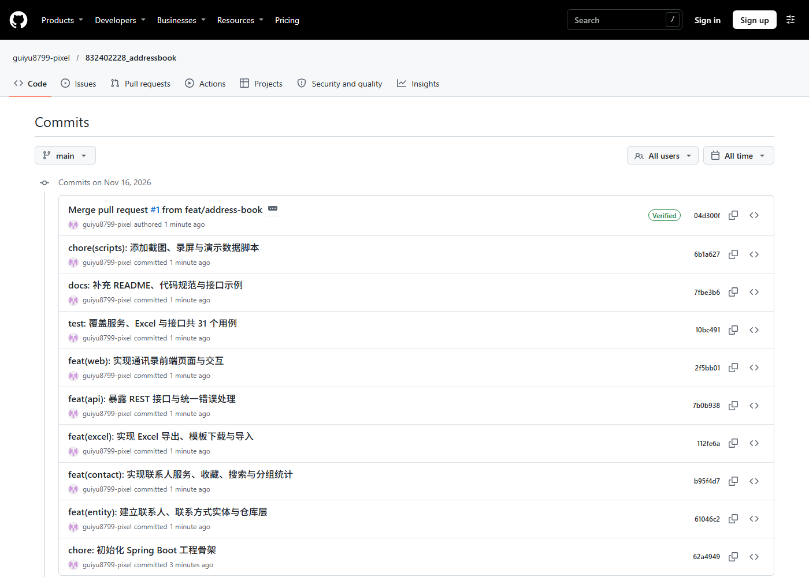

Commits follow Conventional Commits, and each commit does exactly one thing:

| Commit | What it contains |
| --- | --- |
| `chore: initialise the Spring Boot skeleton` | `pom.xml`, configuration, entry point, database-directory bootstrap |
| `feat(entity): contacts, contact methods and repositories` | two tables, indexes, one-to-many relation |
| `feat(contact): contact service, bookmarks, search and group statistics` | DTOs, business logic, error codes |
| `feat(excel): Excel export, template download and import` | POI read/write, row-level validation |
| `feat(api): REST endpoints and unified error handling` | controllers, global exception handler |
| `feat(web): address-book front end and interactions` | markup, styling, scripts |
| `test: 31 cases across services, Excel and the API` | unit tests + integration tests |
| `docs: README, code standard and API examples` | delivery documentation |
| `chore(scripts): screenshot, screen-recording and demo-data scripts` | automated demo material |

**Contribution statistics**: the repository has a single contributor with 11 commits (GitHub excludes merge commits), i.e. 100%.

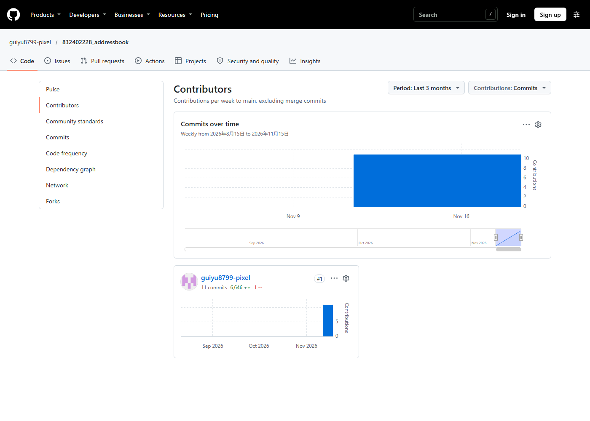

Pull Request #1 records how the feature commits were merged into `main`, and the full history is preserved:

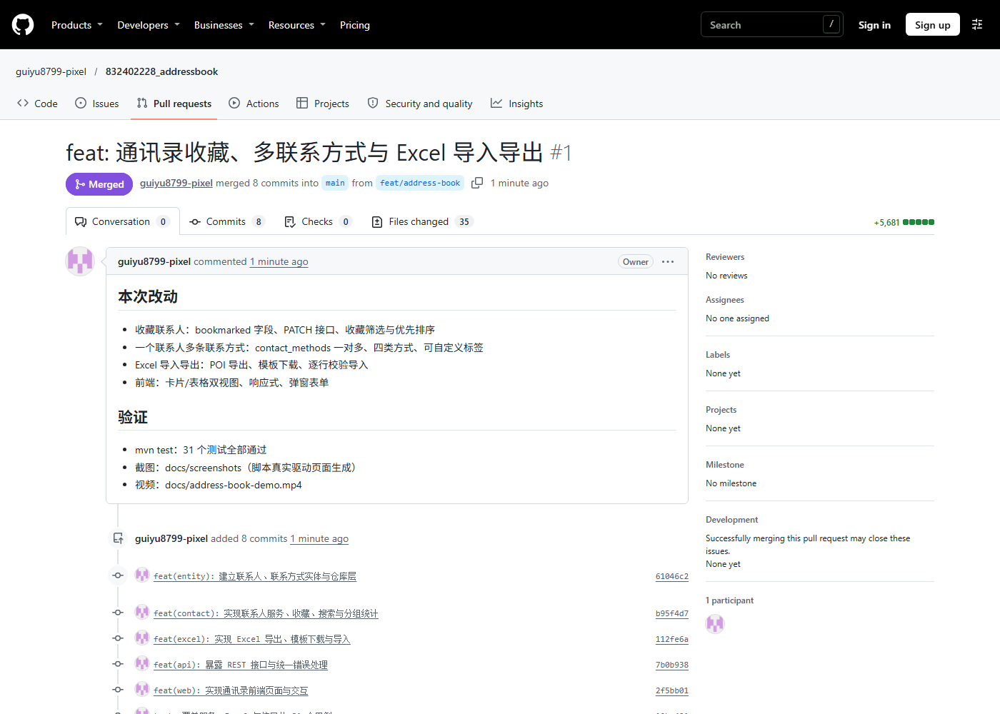

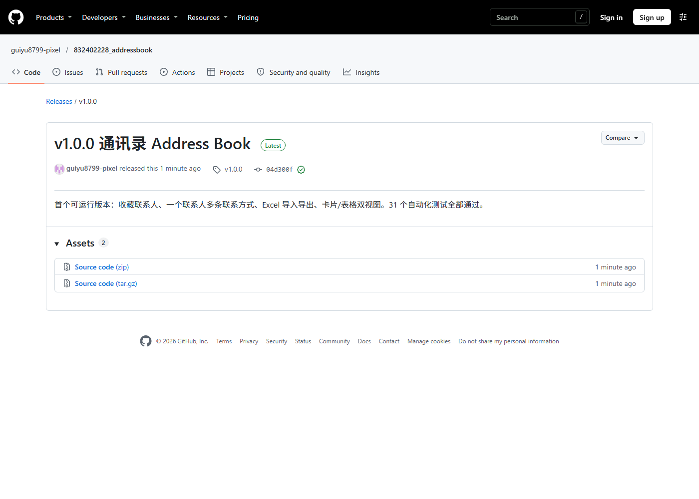

---

## 3. Implementation Design

### 3.1 Data Model

The address book uses only two tables, which are enough for every requirement:

```text
contacts                          contact_methods
--------                          ---------------
id          PK                    id          PK
name        NOT NULL              contact_id  FK -> contacts.id (ON DELETE CASCADE)
company                           type        PHONE / EMAIL / SOCIAL / ADDRESS
title                             label       free text, e.g. "Mobile", "Work email"
grp         group (group is a SQL keyword)  value   number / address / handle / e-mail
notes                             sort_order  order chosen by the user
bookmarked  NOT NULL, favourite flag
created_at / updated_at
```

The key decision is that **contact methods are not columns of `contacts`**. A design such as "phone 1, phone 2, e-mail 1, …" hard-codes the number of columns, and a third phone number has nowhere to go. With a one-to-many table, a contact can have as many methods as needed, each with its own label.

On the JPA side, `@OneToMany(cascade = ALL, orphanRemoval = true)` maintains the relation: updating a contact replaces the whole method list, and Hibernate deletes rows that are no longer referenced, leaving no orphan data (the `updateReplacesMethodsCompletely` test verifies this by counting rows with SQL).

### 3.2 Bookmarking Contacts (25 points)

A bookmark is not a browser-only piece of front-end state — it is persisted data:

1. **Storage**: a boolean column `contacts.bookmarked` with an index `idx_contacts_bookmarked`.
2. **API**: `PATCH /api/contacts/{id}/bookmark` with body `{"bookmarked": true}`; it changes only this column and touches no other field.
3. **Ordering**: every list query uses `ORDER BY bookmarked DESC, name ASC`, so bookmarked contacts naturally float to the top; the same rule applies to both the "All" and "Bookmarked" views.
4. **UI**: a star button (☆ / ★) in the card header; a bookmarked card gets an amber highlight, and the sidebar has a dedicated "Bookmarked" entry with a live count.

The benefit: after a page reload, a browser switch, or an export followed by an import, the bookmark relationship is still there — because it travels with the data, not with the page.

### 3.3 Multiple Contact Methods per Contact (10 points)

- Four kinds of methods: phone `PHONE`, e-mail `EMAIL`, social `SOCIAL`, address `ADDRESS`, modelled as an enum rather than string literals.
- Every method can carry a custom label (mobile, dorm, work e-mail, enterprise WeChat, dorm address, …); labels only affect display, never business logic.
- In the dialog, "＋ Phone / ＋ E-mail / ＋ Social / ＋ Address" adds a row dynamically, and each row can be removed; the client sends a `sortOrder` following the order in which the user added the rows, so the display order matches the input order.
- The server returns `400 INVALID_METHOD_TYPE` for unknown types and silently drops blank values, so no empty rows are stored.

### 3.4 Excel Import and Export (25 points)

This is the largest part of the assignment; the core requirement is that **an exported file must be importable again unchanged**.

**Layout**: one row per contact, one column per kind of information, exactly as required:

| Name (姓名) | Group (分组) | Company (公司) | Title (职位) | Bookmarked (收藏) | Phone (电话) | E-mail (邮箱) | Social (社交) | Address (地址) | Notes (备注) |
| --- | --- | --- | --- | --- | --- | --- | --- | --- | --- |

**Multi-value cells**: when a contact has several methods of the same kind (two phones, three e-mails), they go into one cell, separated by semicolons, in the form `label: value`:

```text
手机: 13800138000; 宿舍: 0591-22861234
```

(The labels are free text and may be Chinese or English; the parser accepts both.)

**Export** (`GET /api/excel/export`):

- POI `XSSFWorkbook` writes the `.xlsx` with a dark-blue bold header, thin borders everywhere, a frozen header row, an auto-filter and per-column widths;
- the Chinese file name is encoded per RFC 5987 (`filename*=UTF-8''...`), so downloads do not end up with a garbled name;
- for each row, `methodsCell` joins all methods of one kind into a single cell.

**Import** (`POST /api/excel/import`):

- header names accept Chinese and English aliases (`姓名/name`, `电话/phone/mobile`, `邮箱/email`, …) and columns may be in any order;
- **row-by-row processing**: a failing row is reported with its line number and skipped; the whole file is not rolled back, so 1 bad row in 200 still imports the other 199;
- the response is `{imported, failed, errors[]}`, and the UI lists the rejected line numbers in a dialog;
- empty files, non-Excel files and empty headers all produce explicit error messages.

**Edge cases**: values such as `https://github.com/xxx` or `mailto:xxx@example.com` contain a colon and must not be split into "label: value". The parser first checks whether the whole segment is a URI (`isUrlLike`); if so it is used as the value, otherwise the text is split at the first colon. Two tests, `keepsUrlAsValue` and `parsesMethodCells`, guard this behaviour.

**Template download** (`GET /api/excel/template`): a workbook with two example rows plus a "How to fill in" sheet, so users never have to guess the format.

### 3.5 Page Styling (10 points)

- **Two views**: a card view (good for reading contact methods) and a table view (good for comparison and scanning), switched with one click over the same data.
- **Layout**: top bar (brand, search, import/export, add) + sidebar (all, bookmarked, per-group counts) + content area; on narrow screens the sidebar collapses into a horizontal filter bar and cards become a single column.
- **Details**: avatars get a gradient derived from a hash of the name; bookmarked cards have an amber border; toasts report success and failure; deletion asks for confirmation; the form validates required fields; `Esc` closes dialogs.
- **Accessibility**: interactive elements use `<button>`, inputs are paired with `<label>`, and icon-only buttons carry `aria-label`.

### 3.6 API Design

| Method | Path | Description |
| --- | --- | --- |
| GET | `/api/contacts?q=&group=&bookmarked=` | list; the three filters can be combined |
| GET | `/api/contacts/summary` | total, bookmarked count, per-group counts |
| GET | `/api/contacts/{id}` | one contact |
| POST | `/api/contacts` | create, returns 201 |
| PUT | `/api/contacts/{id}` | full update |
| DELETE | `/api/contacts/{id}` | delete, returns 204 |
| PATCH | `/api/contacts/{id}/bookmark` | toggle the bookmark |
| GET | `/api/excel/export` | export xlsx |
| GET | `/api/excel/template` | download the template |
| POST | `/api/excel/import` | import xlsx (multipart) |
| GET | `/api/health` | health check |

Keyword search does not stop at names: company, title, group, and every method label and value are matched too, so typing a phone number finds the person. It is implemented with JPA `Specification`, building `Predicate`s conditionally to avoid the `:param is null` style that behaves unpredictably on SQLite; when the query `LEFT JOIN`s `contact_methods`, `query.distinct(true)` prevents a contact with many methods from appearing several times.

---

## 4. Screenshots and Demo Video

The 14 screenshots below were not staged by hand. `scripts/capture.js` drives the real page over the Chrome DevTools Protocol: it clicks real buttons, types into real inputs and uploads a real Excel file, so the images show the actual behaviour of the system.

### 4.1 Empty State and Creation


On first launch the address book is empty and suggests adding a contact or downloading the template.

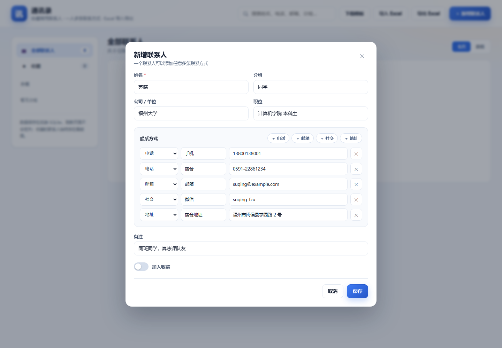

The dialog adds two phones, one e-mail, one WeChat handle and one address for "Su Qing" — five contact methods, the most direct illustration of "one contact, many contact methods".

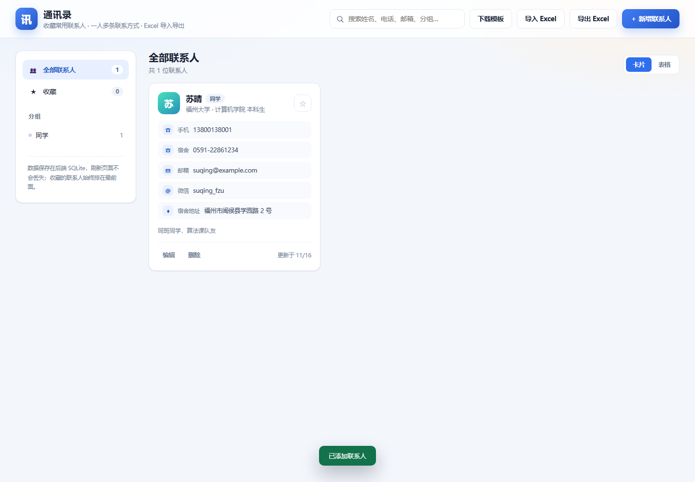

After saving, the contact appears in the list immediately; the data has already been written to the back-end SQLite database.

### 4.2 Bookmarks

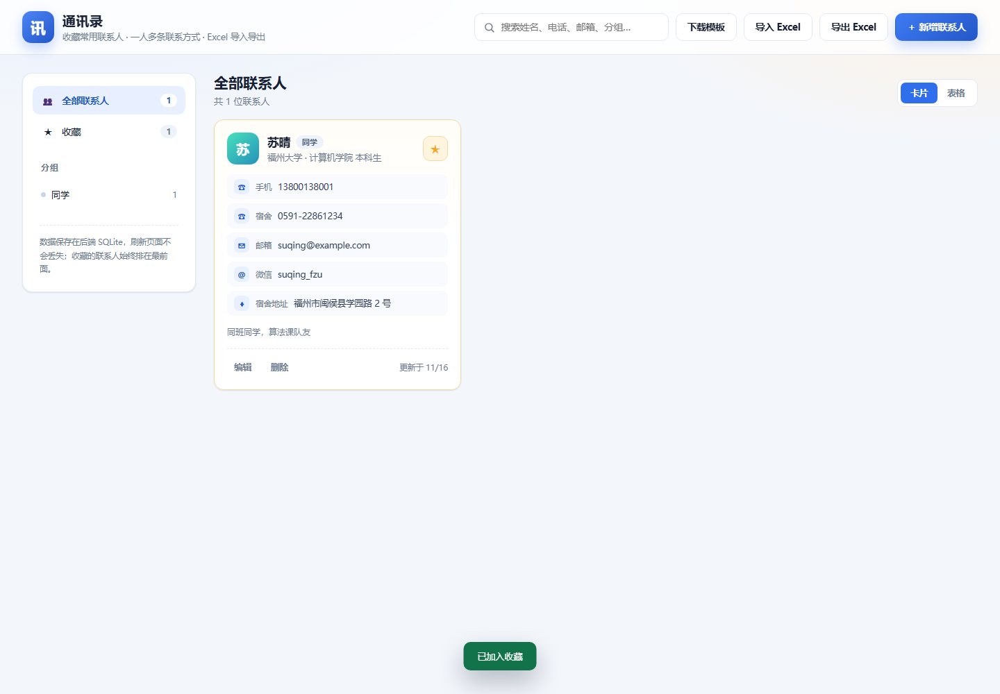

Clicking the star turns the card amber, increments the sidebar count by one, and moves the card to the top of the list.

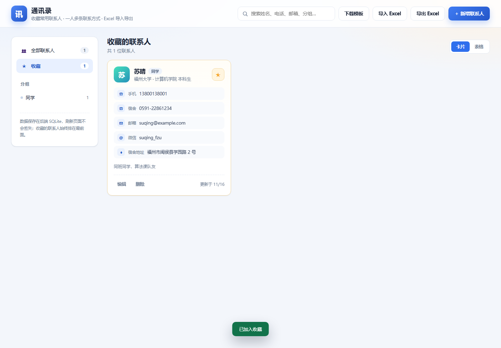

Switching to the "Bookmarked" view leaves only starred contacts.

### 4.3 Excel Import and Export

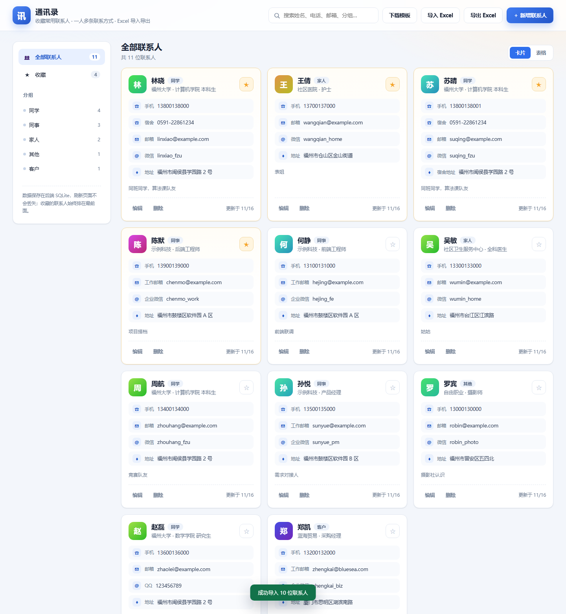

Importing the 10 contacts in `docs/demo-contacts.xlsx` brings the list to 11, and the toast at the bottom reports "Successfully imported 10 contacts".

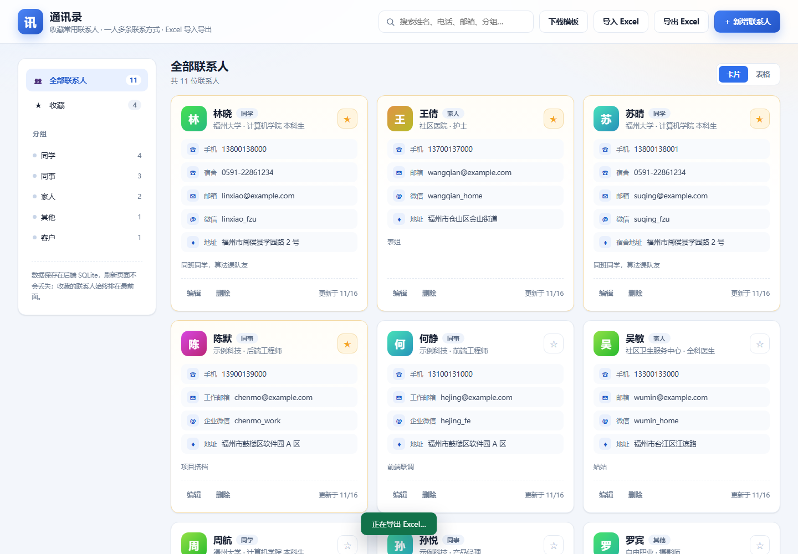

Clicking "Export Excel" makes the back end generate the xlsx and start the download.

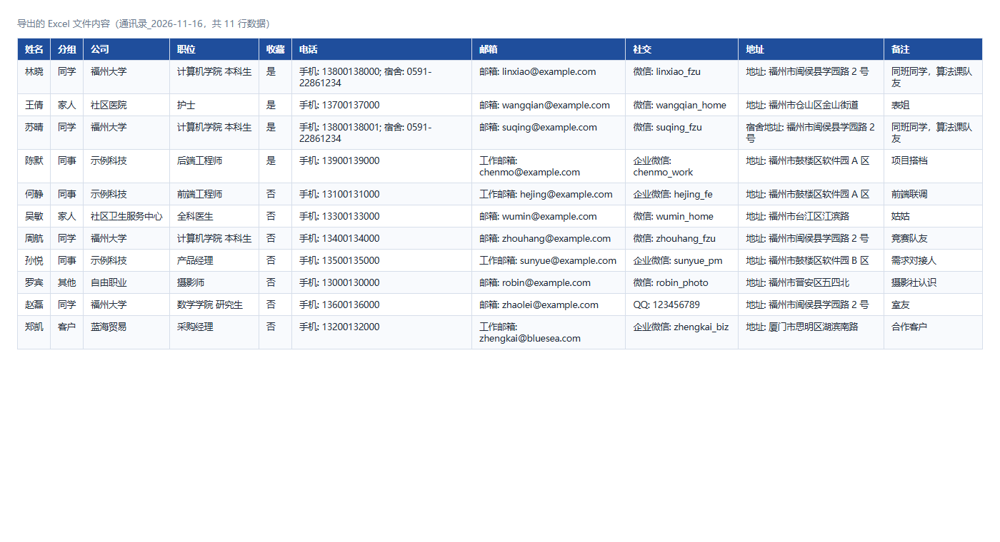

The image above shows the real content of the exported `.xlsx` (the script reads the file and renders it as a table): one row per contact, one column per kind of information, and multiple methods packed into one cell as `label: value; ...`.

### 4.4 Search, Edit and Delete

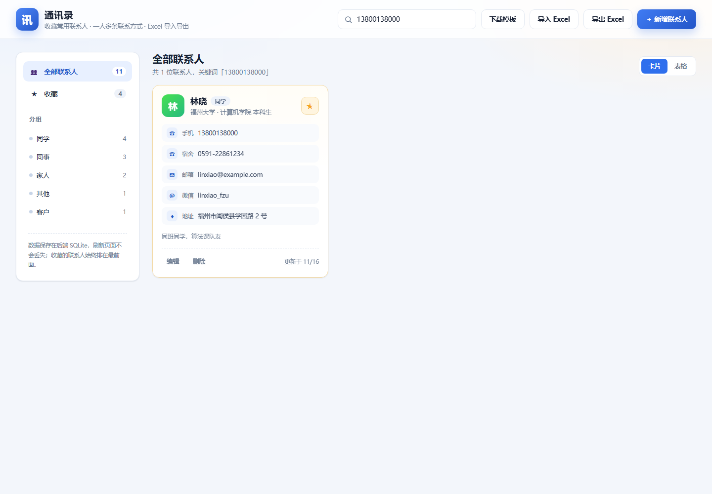

Typing the phone number `13800138000` still finds the contact, because keyword search covers every contact method.

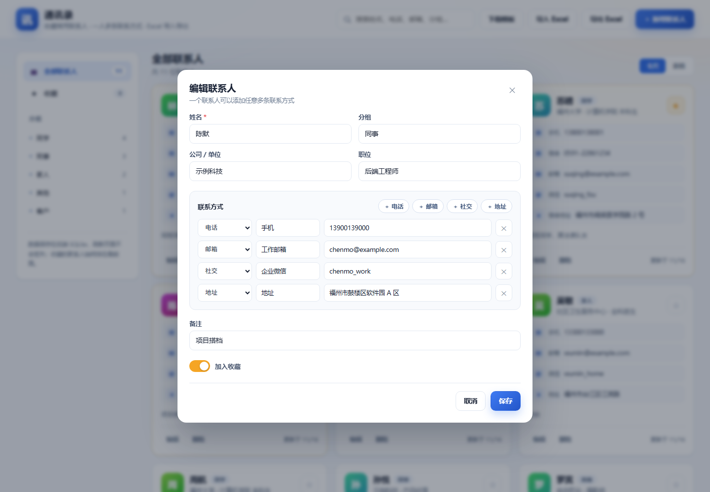

The edit dialog is pre-filled with all of the contact's methods, and any of them can be added, changed or removed.


Deletion asks for confirmation first; confirming calls `DELETE /api/contacts/{id}` and refreshes the list.

### 4.5 Table View and Persistence

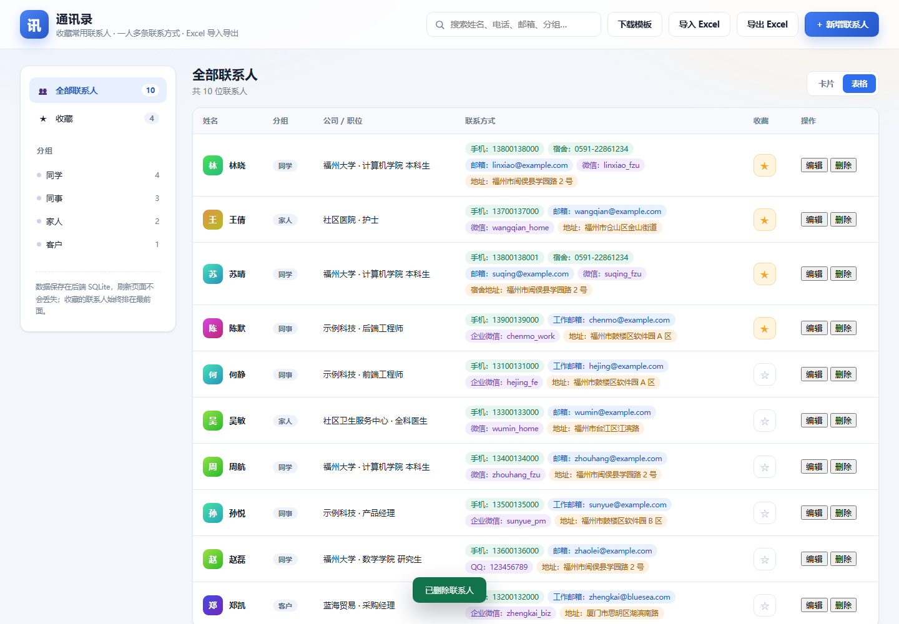

The table view renders contact methods as coloured pills, which makes scanning fast.

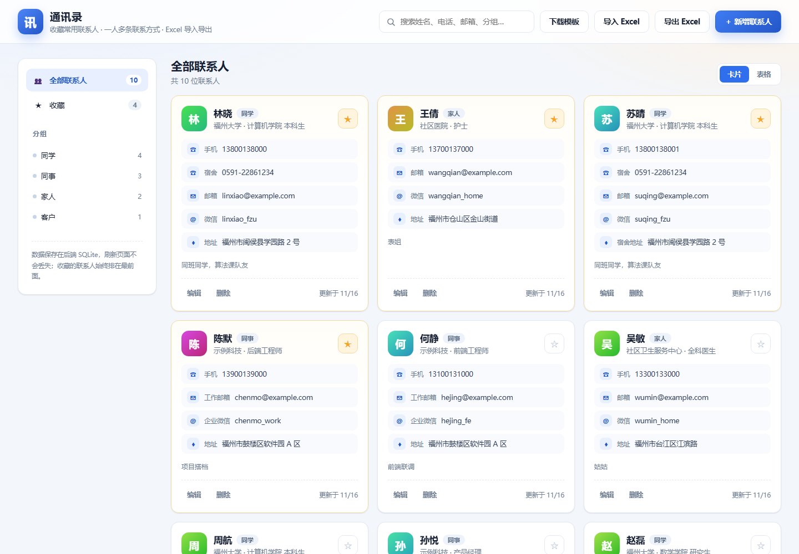

After a forced reload (bypassing the cache) the data is still there — because it lives in the back-end SQLite database, not in the front-end memory.


On narrow screens the sidebar becomes a horizontal filter bar and cards stack in a single column.

### 4.6 Demo Video

The complete walkthrough (24 s, 1280×888) follows the flow "empty state → create → bookmark → import → export → search → edit → delete → table view → reload → mobile":

- Play on GitHub: <https://github.com/guiyu8799-pixel/832402228_addressbook/blob/main/docs/address-book-demo.mp4>
- Direct download: <https://github.com/guiyu8799-pixel/832402228_addressbook/raw/main/docs/address-book-demo.mp4>

---

## 5. Difficulties and Solutions

**1. SQLite does not create the database directory**

The first `java -jar` run failed with `path to './data/addressbook.db': '...\data' does not exist`. SQLite creates the database file but not missing parent directories. The fix is an `EnvironmentPostProcessor` (`DatabaseDirectoryPostProcessor`) that reads `app.database.path` and calls `Files.createDirectories` before the data source is initialised, so normal startup and the test context behave the same and no caller has to remember to create the directory.

**2. URLs were split into "label: value" when reading multi-value cells back**

The export format is `label: value`, but `https://github.com/abc` contains a colon itself; splitting at the first colon yields the label `https` and the value `//github.com/abc`. The fix checks whether the whole segment is a URI (`http://`, `https://`, `mailto:`, `tel:` and the `scheme://` pattern) and treats it as a value, splitting only otherwise. The bug was caught by the `keepsUrlAsValue` test, and `parsesMethodCells` was added afterwards to cover full-width colons and semicolons.

**3. The automation imported the same Excel file twice**

After uploading with CDP's `DOM.setFileInputFiles`, the script dispatched an extra `change` event, so the import endpoint ran twice and the data doubled. It was only noticed when duplicate contacts showed up in a screenshot. Fix: `setFileInputFiles` already fires `change` in current Chromium, so the manual dispatch was removed. Problems like this are hard to spot by reading code; they surface when screenshots are treated as acceptance evidence.

**4. Bookmark ordering, keyword search and the one-to-many relation at the same time**

Keyword search needs `LEFT JOIN contact_methods`, and a contact with five methods produces five joined rows; ordering and pagination on that result would duplicate contacts. Fix: the dynamic Specification sets `query.distinct(true)` whenever it joins, and the service applies one ordering rule (bookmarked first, then name), so SQL and in-memory ordering never disagree.

**5. Garbled file name when downloading Chinese names**

Putting Chinese directly into `Content-Disposition` gives the browser a garbled file name. Fix: RFC 5987 `filename*=UTF-8''` with URL encoding, keeping the `attachment` semantics.

**6. Demo data collided with a manually created contact**

The first batch of screenshots contained two contacts named "Lin Xiao", which looked like an import bug; in fact the demo workbook already contained Lin Xiao and the script created another one by hand. Fix: the hand-created contact was renamed to "Su Qing" with a distinct e-mail, so every contact in the screenshots has exactly one source.

---

## 6. PSP Table

| Phase | Work | Estimated (min) | Actual (min) | Notes |
| --- | --- | --- | --- | --- |
| Requirements analysis | Read the assignment, split it into bookmarks, multiple methods and import/export, define acceptance points | 20 | 20 | close to the estimate |
| System design | Table structure, API, page structure, module boundaries | 25 | 35 | multiple methods and the Excel column layout had to be designed together |
| Database design | Two tables, indexes, cascade, SQLite dialect | 20 | 25 | automatic directory creation took extra time |
| Back-end development | Entities, repositories, services, bookmarks, search, group statistics | 90 | 110 | debugging `Specification` with join + distinct took a while |
| Excel module | Export, template, import, parsing edge cases, error rows | 45 | 70 | URL and full-width character handling was harder than expected |
| Front-end development | Markup, styling, dialogs, import/export interactions | 70 | 95 | responsive layout and the mobile filter bar went through several rounds |
| Testing | Service tests, Excel round-trip tests, API tests | 40 | 55 | tests found two real defects (URL parsing, double import) |
| Demo material | Screenshot script, screen recording, demo workbook | 25 | 40 | CDP file upload and video encoding cost extra time |
| Blog writing | Organise screenshots, describe design and problems | 45 | 50 | every screenshot had to be mapped to a feature |
| **Total** | | **380** | **500** | about 32% over, mostly Excel parsing and front-end details |

---

## 7. Build and Deployment

### Local run

```bash
# build
mvn clean package

# run (either one)
java -jar target/addressbook-1.0.0.jar
# or double-click start.bat / run ./start.sh

# open
http://localhost:8080/
```

Requirements: JDK 8+, Maven 3.6+, Chrome/Edge 90+.

The database file is `./data/addressbook.db` and is created on first start; delete it to reset all data.

### Tests

```bash
mvn test
# Tests run: 31, Failures: 0, Errors: 0
```

### About cloud deployment

Item 1.4 is optional (+15 points). No cloud server was available, so the application was not deployed publicly; instead a one-command local build and a full run video are provided. Deploying to a cloud server only needs: upload the jar → install JDK 8 → `java -jar addressbook-1.0.0.jar` → open port 8080. There are no other external dependencies.

---

## 8. Conclusion

The main takeaway is not that three features were finished, but that a few engineering habits actually paid off:

- **Decide the data model before writing the UI.** Once contact methods became a one-to-many relation, bookmarks, search and import/export all grew naturally from that model; a "phone 1 / phone 2" column design would have forced a schema change for every new requirement.
- **Tests are written for yourself.** At least two of the 31 tests caught real defects (URL split, lost labels after export/import); without them those bugs would have survived until the demo.
- **Screenshots and video are acceptance tools too.** Duplicate imports and colliding demo data were found by looking at the rendered UI, which exposes state problems faster than reading code.
- **Documentation should prove itself.** The README has a requirement-by-requirement table, and the blog shows commit history, PRs, the release, test results and one screenshot per feature, so a reviewer does not have to guess what was implemented.

---

*The code, documentation, screenshots and video all live in this repository and can be verified with the commands in Section 7.*
