# 极限编程作业——通讯录 Address Book

> 课程：软件工程（FZU–MU）　学号：832402228　姓名：周祺粲
> 完成时间：2026-11-17

---

## 课程信息说明

| 项目 | 内容 |
| --- | --- |
| **本次作业所属课程** | 软件工程（FZU–MU） |
| **团队名称** | 个人项目（832402228 周祺粲） |
| **作业要求** | [Extreme Programming（Deadline: November 17, 2026, 23:59）](https://bbs.csdn.net/topics/620593436) |
| **本次作业目标** | 实现一个 Web 通讯录：支持收藏联系人、一个联系人关联多条联系方式、Excel 导入与导出；实践模块划分、Git 分支与 Pull Request 流程、自动化测试与文档写作 |
| **其他参考** | [Spring Boot 官方文档](https://spring.io/projects/spring-boot)、[Apache POI 文档](https://poi.apache.org/)、[SQLite 文档](https://www.sqlite.org/docs.html)、[Google Java Style Guide](https://google.github.io/styleguide/javaguide.html)、[Conventional Commits](https://www.conventionalcommits.org/zh-hans/) |

---

## 目录

- [1. 项目链接](#1-项目链接)
- [2. 提交记录与贡献统计](#2-提交记录与贡献统计)
- [3. 功能实现思路](#3-功能实现思路)
  - [3.1 数据模型](#31-数据模型)
  - [3.2 收藏联系人（25 分）](#32-收藏联系人25-分)
  - [3.3 一个联系人多条联系方式（10 分）](#33-一个联系人多条联系方式10-分)
  - [3.4 Excel 导入导出（25 分）](#34-excel-导入导出25-分)
  - [3.5 页面样式（10 分）](#35-页面样式10-分)
  - [3.6 接口设计](#36-接口设计)
- [4. 运行截图与演示视频](#4-运行截图与演示视频)
- [5. 开发中遇到的困难与解决](#5-开发中遇到的困难与解决)
- [6. PSP 表](#6-psp-表)
- [7. 运行与部署说明](#7-运行与部署说明)
- [8. 总结](#8-总结)

---

## 1. 项目链接

| 内容 | 链接 |
| --- | --- |
| GitHub 仓库 | <https://github.com/guiyu8799-pixel/832402228_addressbook> |
| 代码规范 | <https://github.com/guiyu8799-pixel/832402228_addressbook/blob/main/codestyle.md> |
| 版本发布 | <https://github.com/guiyu8799-pixel/832402228_addressbook/releases/tag/v1.0.0> |
| Pull Request | <https://github.com/guiyu8799-pixel/832402228_addressbook/pull/1> |
| 演示视频 | 仓库内 `docs/address-book-demo.mp4` |
| 云部署地址 | 未做云服务器部署（选做项），本地运行方式见第 7 节 |

**技术栈**：Spring Boot 2.7.18 + Java 8 + Spring Data JPA + SQLite + Apache POI 5.2.5；
前端为原生 HTML5 + CSS3 + ES6，无框架、无构建步骤，由 Spring Boot 直接托管。

这是一个个人项目：需求分析、设计、前后端编码、测试、截图录屏、文档全部由本人独立完成。

---

## 2. 提交记录与贡献统计

仓库 `main` 分支截至截图时共 12 次提交（1 次初始提交 + 9 次功能提交 + 2 次文档与脚本提交），通过两次 Pull Request 合入，远高于「commit 次数 ≥ 3」的要求。

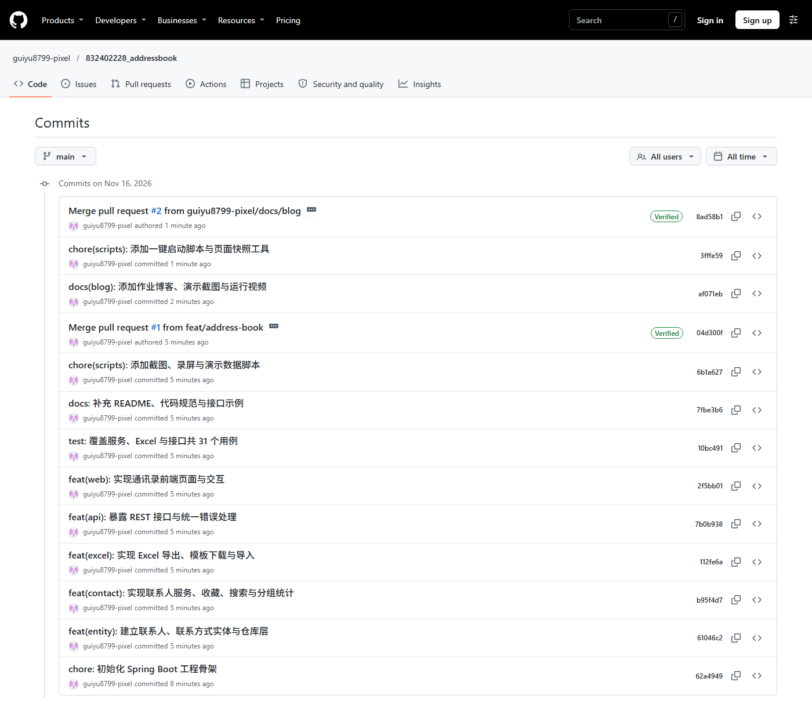

提交按 Conventional Commits 拆分，每次提交只做一件事：

| 提交 | 说明 |
| --- | --- |
| `chore: 初始化 Spring Boot 工程骨架` | pom、配置、启动类、数据库目录引导 |
| `feat(entity): 建立联系人、联系方式实体与仓库层` | 两张表、索引、一对多关系 |
| `feat(contact): 实现联系人服务、收藏、搜索与分组统计` | DTO、业务逻辑、错误码 |
| `feat(excel): 实现 Excel 导出、模板下载与导入` | POI 读写、逐行校验 |
| `feat(api): 暴露 REST 接口与统一错误处理` | Controller、全局异常 |
| `feat(web): 实现通讯录前端页面与交互` | 页面、样式、脚本 |
| `test: 覆盖服务、Excel 与接口共 31 个用例` | 单元测试 + 集成测试 |
| `docs: 补充 README、代码规范与接口示例` | 交付文档 |
| `chore(scripts): 添加截图、录屏与演示数据脚本` | 自动化演示材料 |

**贡献统计**：本仓库只有 1 位贡献者，提交 11 次（GitHub 统计不含 merge commit），占比 100%。

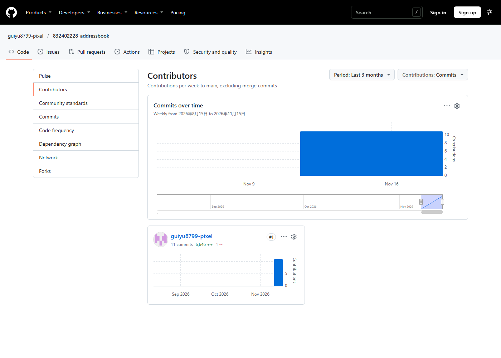

Pull Request #1 记录了这 9 次提交的合并过程，合入 `main` 后保留完整历史：

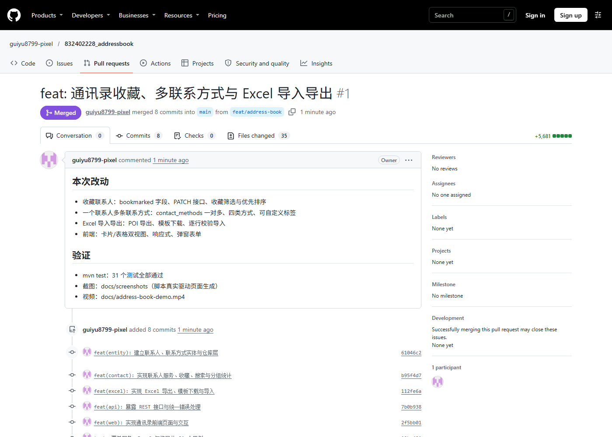

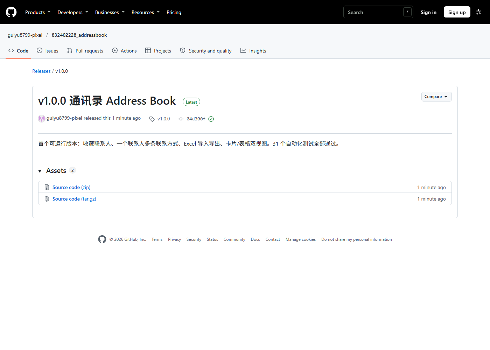

---

## 3. 功能实现思路

### 3.1 数据模型

通讯录只有两张表，但足以支撑全部需求：

```text
contacts                          contact_methods
--------                          ---------------
id          PK                    id          PK
name        NOT NULL              contact_id  FK -> contacts.id (ON DELETE CASCADE)
company                           type        PHONE / EMAIL / SOCIAL / ADDRESS
title                             label       自定义标签，如「手机」「工作邮箱」
grp         分组（group 是关键字）  value       号码 / 邮箱 / 账号 / 地址
notes                             sort_order  用户添加的顺序
bookmarked  NOT NULL，收藏标记
created_at / updated_at
```

关键决策是**多联系方式不建在 `contacts` 表的列里**。如果按「电话 1、电话 2、邮箱 1……」设计，列数会被需求焊死，第三条电话就无处可放；改用一对多表后，一个联系人想加多少条就加多少条，且每条都能带自己的标签。

JPA 侧用 `@OneToMany(cascade = ALL, orphanRemoval = true)` 维护关系：更新联系人时整体替换联系方式列表，Hibernate 会自动删除不再被引用的旧行，不会留下孤儿数据（有测试 `updateReplacesMethodsCompletely` 用 SQL 直接计数验证）。

### 3.2 收藏联系人（25 分）

收藏不是一个只在浏览器里生效的「前端状态」，而是一条落库的数据：

1. **存储**：`contacts.bookmarked` 布尔列，并建 `idx_contacts_bookmarked` 索引。
2. **接口**：`PATCH /api/contacts/{id}/bookmark`，请求体 `{"bookmarked": true}`，只改这一列，不碰其他字段。
3. **排序**：列表查询统一 `ORDER BY bookmarked DESC, name ASC`，收藏的联系人天然置顶；同一个排序规则在「全部」和「收藏」两个视图里都生效。
4. **界面**：卡片右上角星标按钮（☆ / ★），点击后卡片出现琥珀色高亮；侧边栏有独立的「收藏」入口并实时显示数量。

这样设计的好处是：刷新页面、换浏览器、导出再导入之后，收藏关系依然存在——因为它跟着数据走，不跟着页面走。

### 3.3 一个联系人多条联系方式（10 分）

- 四类方式：电话 `PHONE`、邮箱 `EMAIL`、社交 `SOCIAL`、地址 `ADDRESS`，用枚举而不是字符串字面量。
- 每条方式都可以有自定义标签（手机、宿舍、工作邮箱、企业微信、宿舍地址……），标签只影响展示，不参与业务判断。
- 前端弹窗里点「＋ 电话 / ＋ 邮箱 / ＋ 社交 / ＋ 地址」即可动态增加一行，每行可单独删除；提交时按用户添加的顺序带上 `sortOrder`，回显顺序与录入顺序一致。
- 服务端对未知类型返回 `400 INVALID_METHOD_TYPE`，对空白值直接丢弃，避免产生空行。

### 3.4 Excel 导入导出（25 分）

这是本次作业工作量最大的部分，核心是**导出的文件必须能原样导回来**。

**表结构**：一行一个联系人，一列一类信息，完全符合作业要求：

| 姓名 | 分组 | 公司 | 职位 | 收藏 | 电话 | 邮箱 | 社交 | 地址 | 备注 |
| --- | --- | --- | --- | --- | --- | --- | --- | --- | --- |

**多值单元格**：同一类有多条时（两个电话、三个邮箱），写在同一格内，用分号分隔，格式为 `标签: 值`：

```text
手机: 13800138000; 宿舍: 0591-22861234
```

**导出**（`GET /api/excel/export`）：

- POI 的 `XSSFWorkbook` 生成 `.xlsx`，表头深蓝底白字加粗、全表细边框、冻结首行、自动筛选、按列设宽度；
- 中文文件名通过 RFC 5987 的 `filename*=UTF-8''...` 编码，浏览器下载后不会乱码；
- 每一行由 `methodsCell` 把该联系人同类型的多条方式拼成一格。

**导入**（`POST /api/excel/import`）：

- 表头支持中英文别名（`姓名/name`、`电话/phone/mobile`、`邮箱/email`……），列顺序可以不同；
- **逐行处理**：某一行失败只记录行号并跳过，不会让整个文件回滚，200 行里错 1 行仍然能导入 199 行；
- 返回 `{imported, failed, errors[]}`，前端把失败行号列在弹窗里；
- 空文件、非 Excel 文件、表头为空都有明确的错误提示。

**边界处理**：`https://github.com/xxx`、`mailto:xxx@example.com` 这类值本身就带冒号，不能被误拆成「标签: 值」。解析器先判断整段是不是 URI（`isUrlLike`），是则整体作为值；否则才按第一个冒号拆标签。这个细节有专门的测试 `keepsUrlAsValue` 与 `parsesMethodCells` 守着。

**模板下载**（`GET /api/excel/template`）：提供带两行示例的模板和「填写说明」工作表，用户不用猜格式。

### 3.5 页面样式（10 分）

- **两种视图**：卡片视图（适合浏览联系方式）与表格视图（适合对比和批量扫读），同一份数据一键切换。
- **布局**：顶栏（品牌、搜索、导入导出、新增）+ 侧边栏（全部、收藏、分组计数）+ 内容区；窄屏下侧边栏折叠为横向筛选条，卡片单列。
- **细节**：头像按姓名哈希取渐变色；收藏卡片琥珀色描边；Toast 提示成功与失败；删除有二次确认；表单有必填校验；`Esc` 关闭弹窗。
- **可访问性**：按钮用 `<button>`、输入框配 `<label>`、图标按钮带 `aria-label`。

### 3.6 接口设计

| 方法 | 路径 | 说明 |
| --- | --- | --- |
| GET | `/api/contacts?q=&group=&bookmarked=` | 列表，三个过滤条件可组合 |
| GET | `/api/contacts/summary` | 总数、收藏数、分组计数 |
| GET | `/api/contacts/{id}` | 单个联系人 |
| POST | `/api/contacts` | 新建，返回 201 |
| PUT | `/api/contacts/{id}` | 整体更新 |
| DELETE | `/api/contacts/{id}` | 删除，返回 204 |
| PATCH | `/api/contacts/{id}/bookmark` | 收藏开关 |
| GET | `/api/excel/export` | 导出 xlsx |
| GET | `/api/excel/template` | 下载模板 |
| POST | `/api/excel/import` | 导入 xlsx（multipart） |
| GET | `/api/health` | 健康检查 |

关键词搜索不只看姓名：公司、职位、分组、每一条联系方式的标签与内容都会匹配，所以输入手机号也能找到人。实现上用 JPA `Specification` 按条件动态拼 `Predicate`，避免 `:param is null` 这种在 SQLite 上行为不稳定的写法；带 `LEFT JOIN contact_methods` 的搜索会加 `distinct`，防止一个联系人多条方式命中时重复出现。

---

## 4. 运行截图与演示视频

以下 14 张截图不是手工摆拍，而是用 `scripts/capture.js` 通过 Chrome DevTools Protocol 驱动真实页面生成的：脚本真实点击按钮、真实输入文本、真实上传 Excel，因此画面反映的是系统的实际行为。

### 4.1 空状态与新增

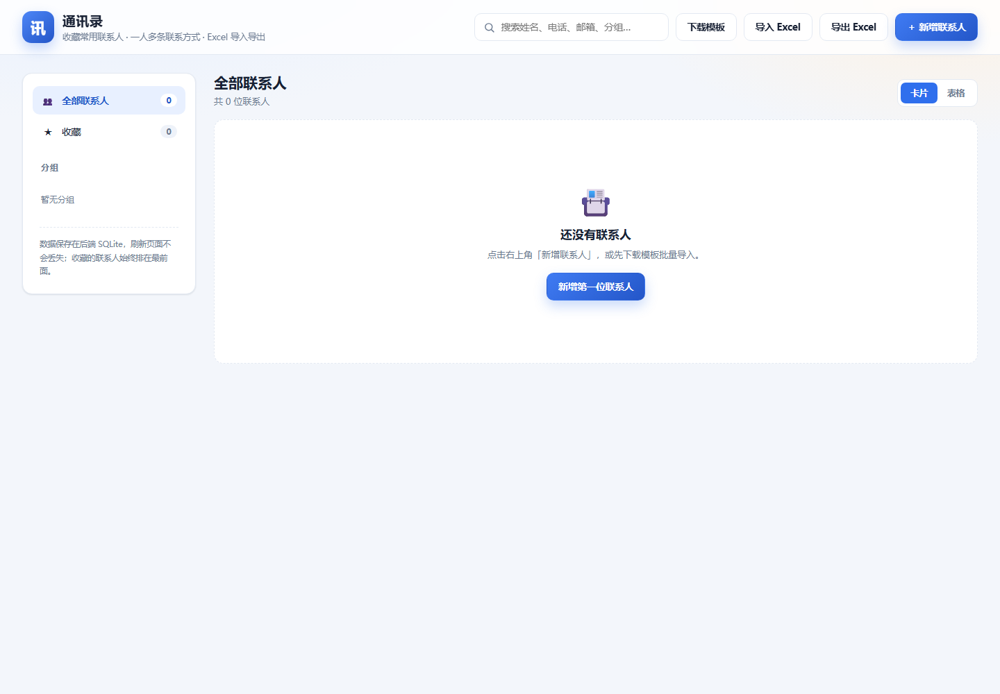

首次打开时通讯录为空，提示「新增联系人」或「下载模板」。

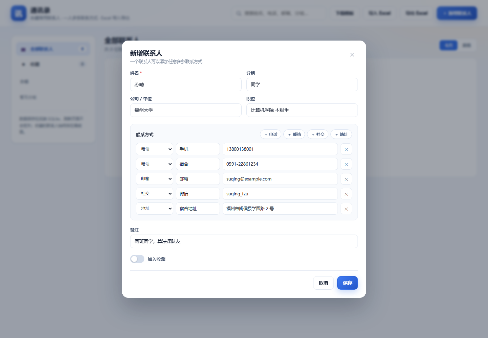

新增弹窗里给「苏晴」添加了 2 个电话、1 个邮箱、1 个微信、1 个地址，共 5 条联系方式——这是「一个联系人多条联系方式」最直观的体现。

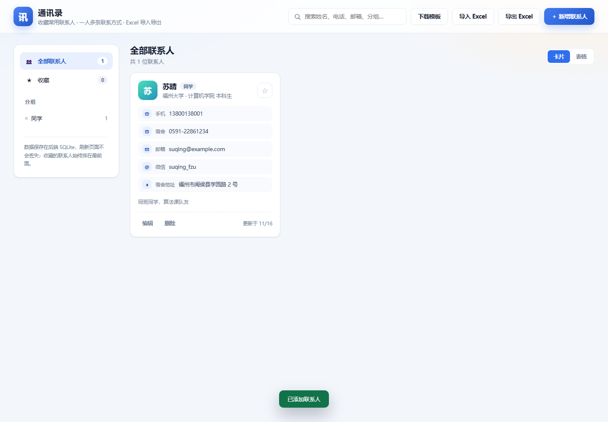

保存后列表立即出现该联系人，数据已经写入后端 SQLite。

### 4.2 收藏

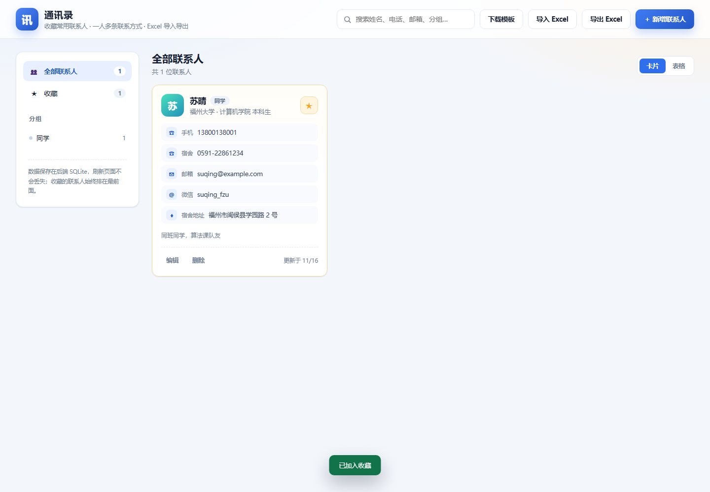

点击星标，卡片变为琥珀色高亮，侧边栏收藏计数 +1，并且排到列表最前面。

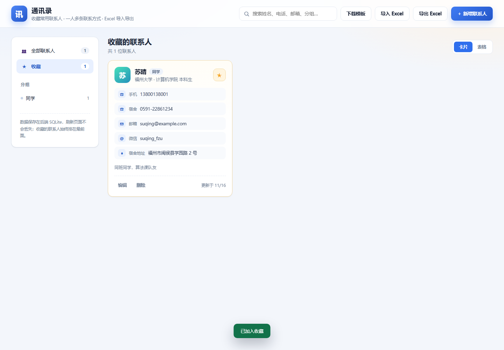

切到「收藏」视图，只剩已星标的联系人。

### 4.3 Excel 导入导出

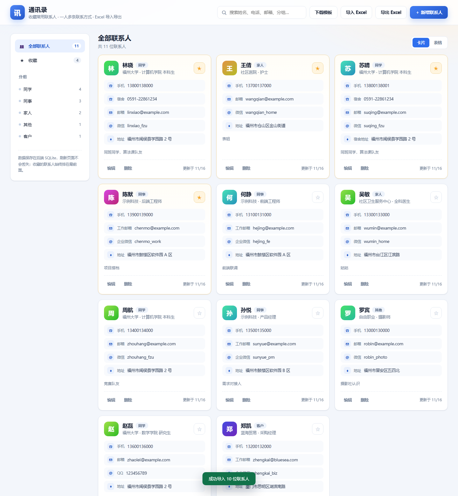

导入 `docs/demo-contacts.xlsx` 中的 10 位联系人，列表变为 11 位，底部 Toast 显示「成功导入 10 位联系人」。

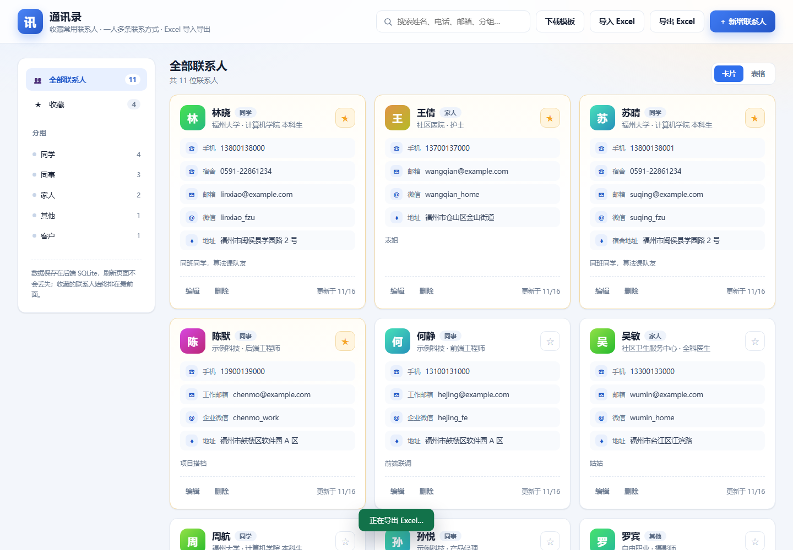

点击「导出 Excel」，后端生成 xlsx 并开始下载。

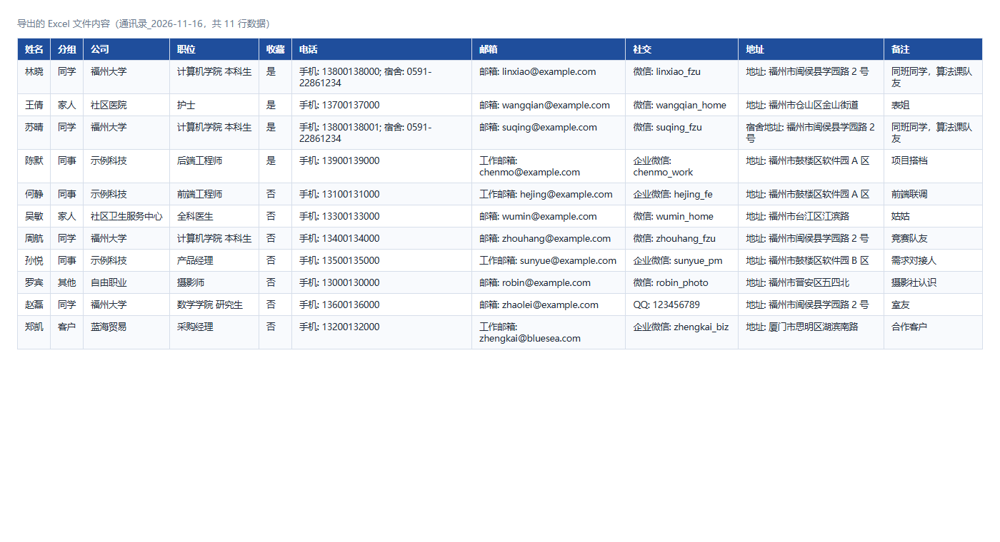

上图是导出的 `.xlsx` 的真实内容（由脚本读取该文件后按表格渲染）：一行一个联系人，一列一类信息，多个联系方式用 `标签: 值; ...` 放在同一格。

### 4.4 搜索、编辑与删除

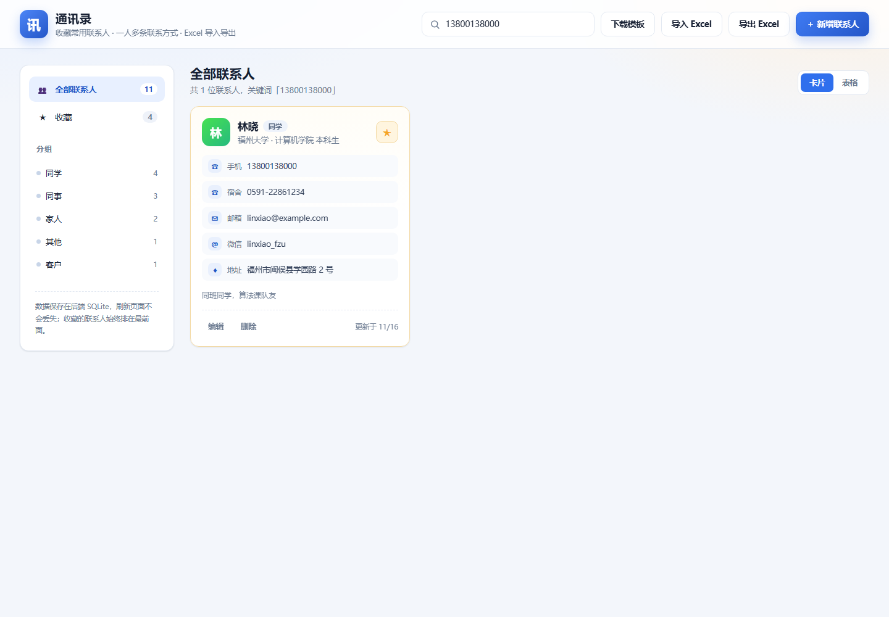

输入手机号 `13800138000` 也能命中联系人，说明关键词检索覆盖了所有联系方式。

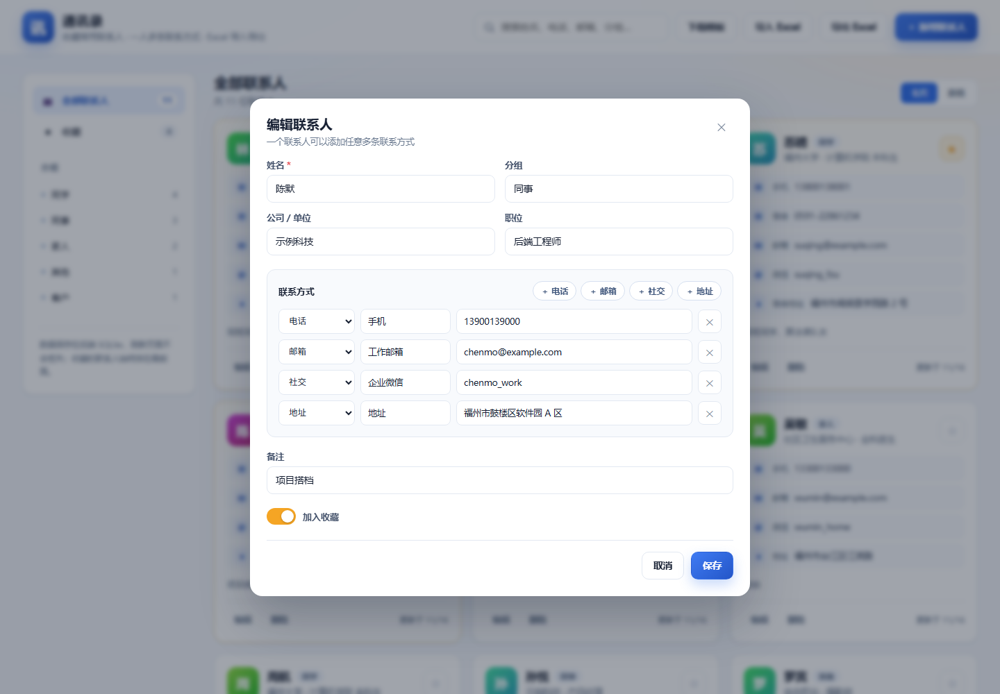

编辑时弹窗回填该联系人的全部联系方式，可以增删改任意一条。

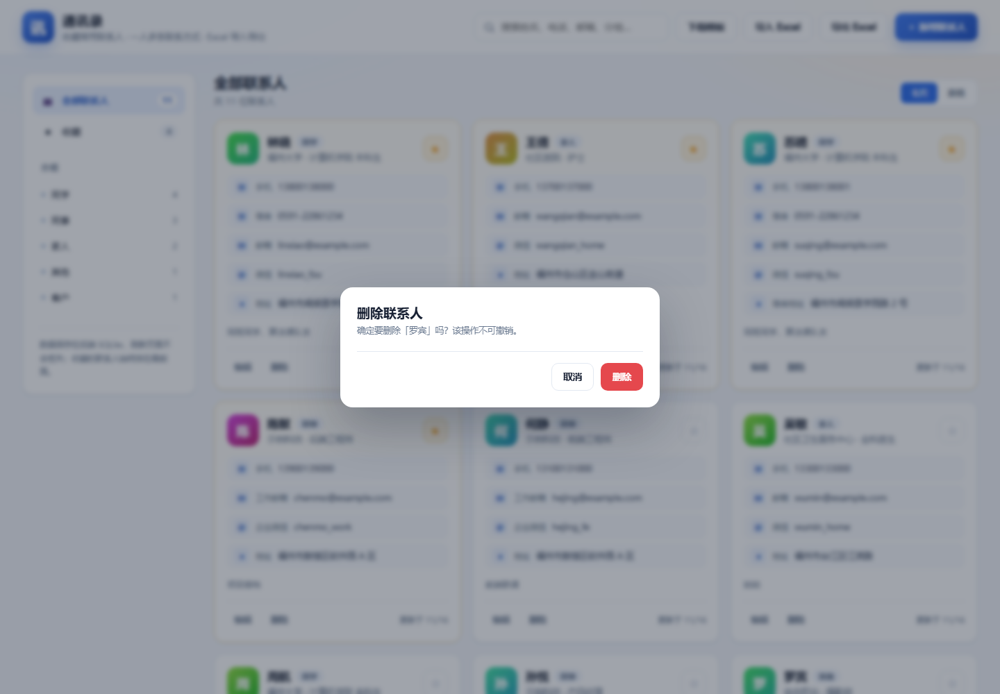

删除前二次确认，确认后调用 `DELETE /api/contacts/{id}` 并刷新列表。

### 4.5 表格视图与持久化

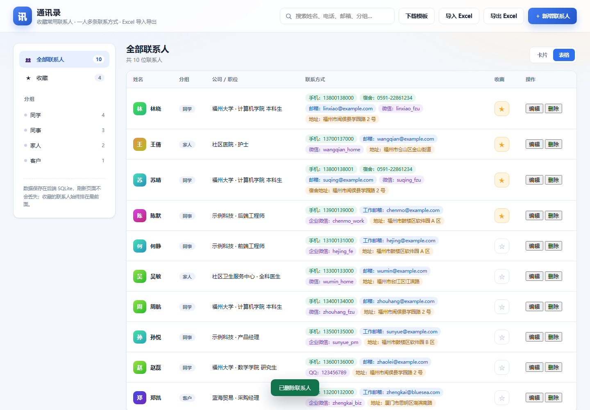

表格视图把联系方式渲染成彩色标签，方便快速扫读。

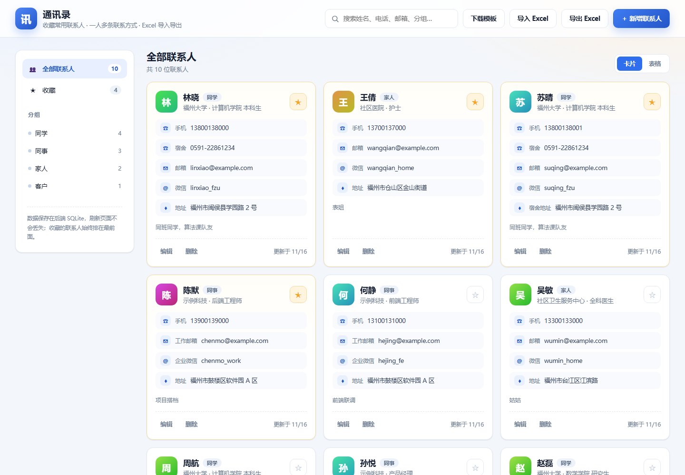

强制刷新页面（绕过缓存）后数据仍在——因为数据在后端 SQLite，不在前端内存。


窄屏下侧边栏折叠成横向筛选条，卡片单列显示。

### 4.6 演示视频

完整运行视频见仓库内 [`docs/address-book-demo.mp4`](docs/address-book-demo.mp4)（24 秒，1280×888），按「空状态 → 新增 → 收藏 → 导入 → 导出 → 搜索 → 编辑 → 删除 → 表格 → 刷新 → 移动端」的顺序走完整流程。

---

## 5. 开发中遇到的困难与解决

**1. SQLite 不会自动创建数据库目录**

第一次运行 `java -jar` 直接报 `path to './data/addressbook.db': '...\data' does not exist`。SQLite 会创建数据库文件，但不会创建缺失的父目录。解决方案是实现一个 `EnvironmentPostProcessor`（`DatabaseDirectoryPostProcessor`），在数据源初始化之前读取 `app.database.path` 并 `Files.createDirectories`，这样普通启动和测试环境行为一致，调用方不需要各自记得建目录。

**2. 多值单元格回读时，网址被误拆成「标签: 值」**

导出格式是 `标签: 值`，但 `https://github.com/abc` 本身带冒号，简单按第一个冒号切分会得到标签 `https`、值 `//github.com/abc`。解决方法是先判断整段是否为 URI（`http://`、`https://`、`mailto:`、`tel:` 及 `scheme://` 模式），是则整体作为值，否则才拆标签。这个 bug 是自动化测试 `keepsUrlAsValue` 抓出来的，修复后补了 `parsesMethodCells` 覆盖全角冒号与分号的情况。

**3. 自动化脚本把同一个 Excel 导入了两次**

用 CDP 的 `DOM.setFileInputFiles` 上传文件后，脚本又手动派发了一次 `change` 事件，导致导入接口被调用两次、数据翻倍。截图里出现重复联系人时才发现。解决：`setFileInputFiles` 在当前 Chromium 中已经会触发 `change`，删掉手动派发即可。这类问题靠肉眼检查截图很难发现，是把「截图当验收」之后才暴露的。

**4. 收藏排序、关键词搜索与一对多关联同时使用**

关键词需要 `LEFT JOIN contact_methods`，一个联系人有 5 条方式时会被 join 出 5 行；如果直接排序分页，列表会出现重复。解决：动态 Specification 里在带 join 时设置 `query.distinct(true)`，并在服务层统一排序（收藏优先、再按姓名），避免 SQL 与内存两套排序规则打架。

**5. 中文文件名下载乱码**

`Content-Disposition` 里直接放中文，浏览器会给出乱码文件名。解决：按 RFC 5987 使用 `filename*=UTF-8''` + URL 编码，并保留 `attachment` 语义。

**6. 演示数据与手工录入重名**

第一版截图里出现了两个「林晓」，看起来像导入 bug，实际是演示 Excel 里本来就有林晓、脚本又手工创建了一个。解决：手工创建的联系人改名为「苏晴」并使用独立邮箱，保证截图里每个联系人都能对应到唯一来源。

---

## 6. PSP 表

| 阶段 | 工作内容 | 估计时间（分钟） | 实际时间（分钟） | 偏差说明 |
| --- | --- | --- | --- | --- |
| 需求分析 | 读作业要求，拆出收藏、多联系方式、导入导出三块，确定验收点 | 20 | 20 | 与估计一致 |
| 系统设计 | 表结构、接口、页面结构、模块划分 | 25 | 35 | 多联系方式与 Excel 列格式需要一起设计，反复调整 |
| 数据库设计 | 两张表、索引、级联关系、SQLite 方言 | 20 | 25 | 目录自动创建多花了一些时间 |
| 后端开发 | 实体、仓库、服务、收藏、搜索、分组统计 | 90 | 110 | Specification 的 join + distinct 调试较久 |
| Excel 模块 | 导出、模板、导入、解析边界、错误行 | 45 | 70 | URL 与全角符号的解析比预想复杂 |
| 前端开发 | 页面结构、样式、弹窗、导入导出交互 | 70 | 95 | 响应式布局与移动端筛选条调整了多轮 |
| 测试 | 服务测试、Excel 往返测试、接口测试 | 40 | 55 | 测试发现了 2 个真实缺陷（URL 解析、重复导入） |
| 演示材料 | 截图脚本、录屏、演示 Excel | 25 | 40 | CDP 上传文件与录屏编码踩坑 |
| 博客撰写 | 整理截图、写实现思路与问题记录 | 45 | 50 | 截图需要逐张对应功能 |
| **合计** | | **380** | **500** | 实际超出约 32%，主要集中在 Excel 解析与前端细节 |

---

## 7. 运行与部署说明

### 本地运行

```bash
# 构建
mvn clean package

# 启动（二选一）
java -jar target/addressbook-1.0.0.jar
# 或双击 start.bat / 执行 ./start.sh

# 访问
http://localhost:8080/
```

环境要求：JDK 8+、Maven 3.6+、Chrome/Edge 90+。

数据库文件在 `./data/addressbook.db`，首次启动自动创建；删除该文件即可重置全部数据。

### 测试

```bash
mvn test
# Tests run: 31, Failures: 0, Errors: 0
```

### 关于云部署

作业中的 1.4 为选做项（+15 分）。本次没有云服务器可用，因此未部署到公网，改为提供可一键运行的本地版本与完整的运行视频。部署到云服务器时只需：上传 jar → 安装 JDK 8 → `java -jar addressbook-1.0.0.jar` → 放行 8080 端口，没有其他外部依赖。

---

## 8. 总结

这次作业最大的收获不是写完了三个功能，而是几条「工程习惯」真的起了作用：

- **先定数据模型，再写界面**。多联系方式一旦建成一对多，收藏、搜索、导入导出全都顺着这个模型长出来；如果一开始图省事用「电话 1/电话 2」的列，后面每加一个需求都要改表。
- **测试是给自己写的**。31 个测试里至少有两个直接抓出了真实缺陷（URL 被拆、导出再导入丢标签），如果没有它们，这些 bug 会留到演示当天。
- **截图和视频也是验收手段**。重复导入、重名数据这些问题，是靠「把界面截下来看」才发现的，比读代码更容易暴露状态问题。
- **文档要能自证**。README 里有要求对照表，博客里有提交记录、PR、Release、测试结果和逐张截图，评审不需要猜哪个功能做没做。

---

*本项目代码、文档、截图与视频均在本仓库中，可按第 7 节命令直接运行复核。*
